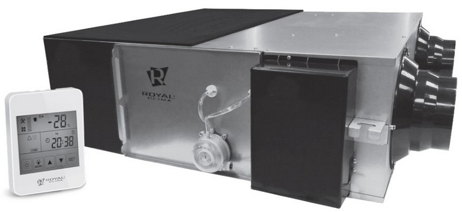
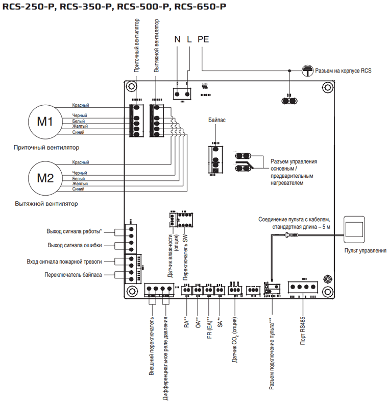

# RoyalClima · ESPHome

<p align="center">
  
</p>

Прошивка на базе ESPHome для связи ESP32 с приточно-вытяжной установкой Royal Clima серии **SOFFIO Primo** по Modbus RTU через RS-485. В руководстве серии перечислены модели **RCS-250-P, RCS-350-P, RCS-500-P и RCS-650-P**. Работа проекта проверена на **RCS-650-P**; совместимость с другими моделями и ревизиями контроллера требует проверки.

Возможна совместимость с установками **Holtop**: **XHBQ-D1.5DMTHA, XHBQ-D2.5DMTHA, XHBQ-D3.5DMTHA, XHBQ-D5DMTHA, XHBQ-D6.5DMTHA, XHBQ-D8DMTHA, XHBQ-D10DMTHA, XHBQ-D13DMTHA, XHBQ-D15DMTHA, XHBQ-D20DMTHA и XHBQ-D26DMTHA** — при совпадении протокола Modbus и карты регистров. Работа прошивки с этими моделями не проверена; совместимость требует подтверждения для конкретной модели и ревизии контроллера.

ESP32 позволяет получать показания и управлять установкой через локальный веб-интерфейс, а также подключать её к умному дому на базе **Home Assistant** через native API ESPHome. Также возможна работа через MQTT после настройки компонента `mqtt` и подключения к брокеру. Для самостоятельной работы без клиента API нужна настройка, описанная ниже.

В данном проекте вы найдете:

- Скомпилированные прошивки для ESP32: [firmware для первоначальной установки](bin/royalclima-firmware.factory.bin) и [OTA для обновления](bin/royalclima-firmware.ota.bin).
- [Конфигурацию для ESPHome](ESPHome/RoyalClima.yaml).
- [Документацию](docs/): [руководство SOFFIO Primo](docs/2020_RC_Manual_Soffio-Primo.pdf) и [протокол Modbus DC (Primo)](docs/Modbus%20protocol%20-%20DC%20%28Primo%29.pdf).
- Файлы для использования в Hass: [пакет шаблонов и управления](Hass/royal_clima.yaml) и [пример вкладки дашборда](Hass/home-assistant-card.yaml).

<p align="center">
  
</p>


## Что потребуется

| Компонент | Назначение и требования |
|---|---|
| ESP32 | Плата разработки, совместимая с конфигурацией `esp32dev`. Прошивка использует ESP-IDF |
| Преобразователь UART ↔ RS-485 | Логические уровни на стороне ESP32 — 3,3 В. Текущая схема предполагает управление направлением через объединённые DE и /RE |
| Источник питания | Для ESP32 и преобразователя, с напряжениями по спецификации выбранных плат |

### Варианты плат

Для текущей конфигурации подойдут платы классического ESP32 на базе **ESP32-WROOM-32**, например ESP32-DevKitC или DevKit V1, с доступными GPIO16, GPIO17 и GPIO18. На платах ESP32-WROVER GPIO16 и GPIO17 заняты внутренними подключениями — потребуется выбрать другие выводы. См. [распиновку и ограничения ESP32-DevKitC](https://docs.espressif.com/projects/esp-dev-kits/en/latest/esp32/esp32-devkitc/user_guide.html). Для ESP32-C3, ESP32-S3 и других вариантов нужно отдельно адаптировать параметры платы и GPIO и собрать прошивку под выбранную плату.

Варианты преобразователя UART ↔ RS-485:

- **Модуль на MAX3485 с питанием 3,3 В** и выводами DI, RO, DE, /RE — вариант для схемы ниже. [MAX3485 рассчитан на питание 3,3 В](https://www.analog.com/en/products/max3485.html); параметры готовой платы нужно сверять отдельно.
- **Модуль с автоматическим переключением направления** — не требует сигнала EN; для него в своей копии YAML нужно убрать `flow_control_pin` из `uart`.
- **Изолированный преобразователь** — подходит при совместимых уровнях UART; питание и соединение земель выполняются по схеме его производителя.

У модулей, рассчитанных на 5 В, проверьте уровень выхода RO: на вход ESP32 должен поступать сигнал не выше 3,3 В. Перечисленные варианты — ориентир для выбора; конкретные платы преобразователей в проекте пока не зафиксированы.

### Упрощённая схема подключения

<p align="center">
  
</p>

```text
+--------------------+        +------------------------+        +--------------------+
|    Рекуператор     |        |    UART <-> RS-485     |        |       ESP32        |
|                GND |~       |                        |        |                    |
|    Порт RS-485   B |<------>| B                   DI |<-------| GPIO17 / TX        |
|                  A |<------>| A                   RO |------->| GPIO16 / RX        |
|                12V |~       |                DE + RE |<-------| GPIO18 / EN        |
|                    |        |                    GND |--------| GND                |
|                    |        |                    VCC |<-------| 3V3 *              |
+--------------------+        +------------------------+        |                    |
                                                                | USB / питание      |
                                                                +--------------------+
* Питание 3,3 В показано для соответствующего модуля на MAX3485.
  ESP32 питается через USB либо вход питания выбранной платы.
```

| Вывод ESP32 | Контакт преобразователя | Функция |
|---|---|---|
| GPIO17 | DI / TXD-вход | Передача от ESP32 |
| GPIO16 | RO / RXD-выход | Приём в ESP32 |
| GPIO18 | DE и /RE, соединённые вместе | Высокий уровень — передача, низкий — приём |
| GND | GND логической стороны | Общая опорная точка UART |

Обозначения TXD/RXD и A/B на модулях могут различаться: сверяйте их с документацией конкретного преобразователя. Для изолированного модуля учитывайте разделение логической и шинной сторон. Подключение сигнальной земли на стороне установки и согласование линии определяются документацией оборудования и топологией шины.

## Прошивка ESPHome

### Возможности

- Чтение четырёх температур: наружного воздуха, возвратного воздуха, притока и датчика разморозки.
- Включение и выключение установки, независимый выбор ступени приточного и вытяжного вентиляторов.
- Отображение байпаса, разморозки, пожарного входа, внешнего форсирования и форсирования по CO₂.
- Расшифровка ошибок на русском языке с исходным числовым кодом.
- Чтение уставок влажности и нагревателя, настроенного интервала напоминания о фильтре.
- Диагностика Modbus, Wi-Fi и времени работы ESP32.
- Локальный веб-интерфейс на порту 80, native API для HA и OTA ESPHome.

Уставки влажности, нагревателя и интервала фильтра в этой конфигурации **только отображаются**. Запись реализована для регистров питания и скоростей вентиляторов. Измеренные CO₂ и влажность, наработка вентиляторов, настройка байпаса и разморозки в текущую конфигурацию пока не включены.

### Подготовка и установка

Для самостоятельной сборки нужен ESPHome с поддержкой используемых компонентов, `esphome.devices` и ESP-IDF. Минимальная проверенная версия ESPHome пока не зафиксирована; перед прошивкой проверьте YAML в своей версии ESPHome.

1. Скопируйте [RoyalClima.yaml](ESPHome/RoyalClima.yaml) в рабочий каталог ESPHome.
2. Создайте рядом `secrets.yaml`. В исходной конфигурации заданы две сети Wi-Fi, поэтому нужны четыре значения:

   ```yaml
   wifi_ssid: "Основная сеть"
   wifi_password: "Пароль основной сети"
   wifi_ssid2: "Резервная сеть"
   wifi_password2: "Пароль резервной сети"
   ```

   Если используется одна сеть, удалите вторую запись из `wifi.networks` в своей копии конфигурации.
3. Сверьте GPIO, скорость порта и адрес установки в `substitutions` с подключением и настройками контроллера.
4. Проверьте конфигурацию, соберите и загрузите прошивку:

   ```console
   esphome config RoyalClima.yaml
   esphome run RoyalClima.yaml
   ```

   Для первой загрузки выберите USB, для последующих обновлений можно использовать OTA ESPHome. Готовый `factory.bin` прошивается инструментом, поддерживающим заводские образы ESPHome; `ota.bin` предназначен для OTA, эти файлы не взаимозаменяемы.
5. После подключения к Wi-Fi откройте `http://royalclima.local/` либо IP-адрес ESP32. Если настроенная сеть недоступна, через 90 секунд предусмотрены резервная точка доступа и captive portal для настройки Wi-Fi.

Веб-сервер использует локальные ресурсы (`local: true`), поэтому для загрузки его интерфейса не нужен внешний CDN. В YAML включён OTA-компонент `esphome`.

### Параметры обмена

| Параметр | Значение в YAML | Примечание |
|---|---|---|
| UART TX / RX / EN | GPIO17 / GPIO16 / GPIO18 | Меняются в `substitutions` |
| Скорость | 9600 бод | По протоколу: SW4-4 ON — 9600, OFF — 4800 |
| Формат UART | 8N1 | 8 бит данных, без чётности, 1 стоп-бит |
| Modbus-адрес | 1 | Должен совпадать с параметром 08 контроллера; это адрес Modbus, а не IP сети |
| Период опроса | 10 с | `refresh_interval` |
| Ожидание ответа | 1500 мс | `response_timeout` |
| Пауза между транзакциями | 100 мс | `turnaround_time` |
| Повтор команды | 1 | `max_cmd_retries` |
| Тайм-аут показаний | 60 с | `stale_timeout` |

Чтение holding-регистров выполняется командой FC03. Регистры 9–20 читаются одним непрерывным блоком, 25 и 27 — отдельно. Команды управления записывают регистры 9–11 через FC06. При запуске ESP32 конфигурация не отправляет команду восстановления питания установки.

Ступени вентилятора 0–10 преобразуются в коды протокола:

| Ступень | 0 / Стоп | 1 | 2 | 3 | 4 | 5 | 6 | 7 | 8 | 9 | 10 |
|---|---|---|---|---|---|---|---|---|---|---|---|
| Код | 0 | 2 | 3 | 5 | 8 | 9 | 10 | 11 | 12 | 13 | 14 |

Это заданные ступени, а не измеренные обороты и не проценты скорости. Температуры из регистров 12–15 пересчитываются как исходное значение минус 40.

### Самостоятельная работа и Home Assistant

В текущем YAML включён `api:`, MQTT закомментирован. Для Home Assistant используется интеграция ESPHome, MQTT-брокер не нужен.

Для работы через [MQTT](https://esphome.io/components/mqtt/) включите компонент `mqtt` и задайте адрес брокера и данные подключения в `secrets.yaml`. Если native API не используется, удалите `api:` либо отключите его тайм-аут перезагрузки, как показано ниже. Пакет и дашборд из `Hass` используют сущности подключения через native API; при переходе на MQTT их ссылки и индикатор связи нужно сверить с созданными MQTT-сущностями.

При работе без HA или другого постоянно подключённого клиента native API задайте в своей копии:

```yaml
api:
  reboot_timeout: 0s
```

Это отключает автоматическую перезагрузку из-за отсутствия клиента API. По умолчанию ESPHome использует тайм-аут 15 минут; соединение с веб-интерфейсом не заменяет подключение клиента native API. См. [документацию native API ESPHome](https://esphome.io/components/api/).

Текущий YAML не задаёт шифрование API, пароль OTA и авторизацию веб-сервера. Эти параметры следует настроить для своей сети перед эксплуатацией.

### Актуальность данных и состояния связи

`ESP32 connection` показывает подключение к клиенту native API, а `Vent system Online` — оперативное состояние обмена с рекуператором по Modbus. Это разные соединения.

При прекращении обновлений исходные числовые показания через 60 секунд становятся неизвестными; вычисляемые сущности отражают это при следующем пересчёте. `Seconds since last data` отсчитывает время с успешного чтения **регистра 9**, а не с ответа любой группы. Состояние Online не гарантирует свежесть отдельно читаемых регистров 25 и 27.

### Полный перечень сущностей

Ниже приведены имена из YAML. Сущности установки относятся к устройству `Ventilation System`, диагностика ESP32 — к `Royal Clima`. Фактические `entity_id` в HA зависят также от реестра сущностей и ранее выполненных переименований.

**¹** — сущность отключена по умолчанию в HA; при необходимости её можно включить в настройках интеграции. Исходные значения продолжают использоваться прошивкой для вычисления состояний.

#### Числовые сенсоры установки

| Имя в ESPHome | Назначение | Источник |
|---|---|---|
| Power state raw ¹ | Исходное питание: 0 — выключена, 1 — включена | Регистр 9 |
| Supply fan speed code ¹ | Исходный код ступени притока | Регистр 10 |
| Exhaust fan speed code ¹ | Исходный код ступени вытяжки | Регистр 11 |
| Return air temperature | Возвратный воздух из помещения RA, °C | Регистр 12 |
| Outdoor air temperature | Наружный воздух OA, °C | Регистр 13 |
| Supply Air Temperature | Приточный воздух SA, °C | Регистр 14 |
| Defrost temperature | Датчик разморозки, °C | Регистр 15 |
| External boost signal raw ¹ | Внешнее форсирование: 0/1 | Регистр 16 |
| CO2 boost signal raw ¹ | Форсирование по CO₂: 0/1, не ppm | Регистр 17 |
| Status flags raw ¹ | Исходная маска пожарного входа, байпаса и разморозки | Регистр 18 |
| Humidity setpoint | Уставка влажности 1–99 %, не измерение | Регистр 19 |
| Error flags raw ¹ | Исходная битовая маска ошибок | Регистр 20 |
| Filter interval code ¹ | Код 0/1/2/3 → 45/60/90/180 дней | Регистр 25 |
| Heater temperature setpoint | Уставка температуры нагревателя 10–25 °C | Регистр 27 |
| Supply fan speed | Ступень притока 0–10 | Из регистра 10 |
| Exhaust fan speed | Ступень вытяжки 0–10 | Из регистра 11 |
| Filter reminder interval | Настроенный период напоминания о фильтре, дни; не остаток до обслуживания | Из регистра 25 |
| Seconds since last data | Давность успешного чтения регистра 9, секунды | Диагностика обмена |
| Offline events | Число переходов Modbus-контроллера в offline после запуска ESP32 | Диагностика обмена |

#### Двоичные сенсоры установки

| Имя в ESPHome | Назначение | Источник |
|---|---|---|
| Vent system Online | Состояние связи с рекуператором | Диагностика Modbus |
| Ventilation power | Включена/выключена по регистру; не подтверждение вращения вентиляторов | Регистр 9 |
| Bypass open | Байпас открыт/закрыт; при одинаковых битах открытия и закрытия — неизвестно | Регистр 18, биты 1–2 |
| Bypass closed ¹ | Дополнительный отдельный признак закрытия | Регистр 18, бит 2 |
| Defrost active | Активна разморозка | Регистр 18, бит 3 |
| Fire alarm | Активен пожарный вход установки | Регистр 18, бит 0 |
| Ventilation error | Есть ошибка: ненулевая маска | Регистр 20 |
| External boost active | Активно внешнее форсирование высокой скорости | Регистр 16 |
| CO2 boost active | Активно форсирование по CO₂; не концентрация газа | Регистр 17 |

#### Текстовые сенсоры установки

| Имя в ESPHome | Назначение |
|---|---|
| Ventilation status | Русское описание питания, байпаса, разморозки и пожарного сигнала |
| Error description | Русская расшифровка ошибок и исходный числовой код |

Расшифровываются ошибки датчиков OA, RA, EA и SA, EEPROM, приточного и вытяжного вентиляторов. Неизвестные биты также отмечаются в описании. При отсутствии актуальных исходных данных текстовые сенсоры выводят «Нет актуальных данных».

#### Диагностика ESP32 и управление

| Тип | Имя в ESPHome | Назначение |
|---|---|---|
| sensor | WiFi signal | Уровень сигнала Wi-Fi, дБм |
| sensor | Uptime | Время после перезагрузки ESP32, секунды |
| binary_sensor | ESP32 connection | Подключение к клиенту native API |
| button | ESP32 Reboot | Перезагрузка только ESP32; контроллер рекуператора не перезапускается |
| switch | Ventilation control | Включение/выключение установки, регистр 9 |
| select | Supply speed control | Ступень притока: «Стоп», 1–10, регистр 10 |
| select | Exhaust speed control | Ступень вытяжки: «Стоп», 1–10, регистр 11 |

## Использование в Home Assistant

### Подключение ESPHome

Добавьте ESP32 через интеграцию ESPHome в HA, используя обнаруженное устройство либо его адрес. Сверьте созданные сущности со ссылками в пакете и дашборде. В файлах проекта используются:

- `ventilation_system_*` — показания и управление установкой;
- `royal_clima_*` — диагностика ESP32 и шаблонные обёртки управления HA;

### Пакет шаблонов и управления

[Hass/royal_clima.yaml](Hass/royal_clima.yaml) — пакет HA с шаблонным выключателем и двумя селекторами, которые могут понадобиться в UI.

1. Скопируйте файл в `/config/packages/royal_clima.yaml`.
2. Подключите пакеты в `configuration.yaml`, объединив настройку с уже существующим разделом `homeassistant`, если он есть:

   ```yaml
   homeassistant:
     packages: !include_dir_merge_named packages
   ```

   Файл уже содержит внешний ключ `royal_clima`, поэтому этот пример использует именно `!include_dir_merge_named`.
3. Сверьте исходные `entity_id` внутри шаблонов и действий с вашей установкой.
4. Выполните проверку конфигурации HA и перезапустите его.

Для дашборда и собственных автоматизаций используйте:

| Сущность HA | Действие |
|---|---|
| `switch.royal_clima_power` | Включение/выключение установки |
| `select.royal_clima_supply_speed` | Выбор ступени притока |
| `select.royal_clima_exhaust_speed` | Выбор ступени вытяжки |

Обёртки проверяют Online и наличие исходных состояний; при потере данных становятся недоступны. Это удобство интерфейса, а не защитная блокировка и не гарантия свежести каждой группы регистров.

В текущем пакете **нет готовых автоматизаций** по расписанию, влажности или CO₂. Он предоставляет сущности для таких сценариев. Например, действие в собственной автоматизации для выбора третьей ступени притока:

```yaml
# Фрагмент списка actions собственной автоматизации.
- action: select.select_option
  target:
    entity_id: select.royal_clima_supply_speed
  data:
    option: "3"
```

### Пример дашборда

[Hass/home-assistant-card.yaml](Hass/home-assistant-card.yaml) содержит пример вкладки «ПВУ», а не одну карточку. Вставьте содержимое в YAML-редактор конфигурации отдельной вкладки дашборда.

Нужны установленные и подключённые ресурсы [Mushroom](https://github.com/piitaya/lovelace-mushroom), [stack-in-card](https://github.com/custom-cards/stack-in-card) и [fold-entity-row](https://github.com/thomasloven/lovelace-fold-entity-row). Для температурного графика показания должны сохраняться Recorder.

Вкладка включает:

- отдельные индикаторы связи ESP32 → HA и ESP32 → рекуператор;
- управление питанием и скоростями через обёртки пакета;
- текущие температуры и историю за 24 часа;
- состояния байпаса, разморозки и форсирования;
- сообщения об ошибках и пожарном входе;
- сворачиваемую диагностику, уставки и интервал фильтра;
- время работы ESP32 и перезагрузку с подтверждением.

Управление и температуры скрываются при потере соответствующих соединений. Перезагрузка через `button.royal_clima_esp32_reboot` относится только к ESP32; `sensor.royal_clima_uptime` хранит секунды, а бейдж переводит их в дни, часы и минуты.

В примере сохранены два бейджа конкретной установки: `binary_sensor.mega1_port2` и `switch.mega1_port9`. Для своего дашборда замените их подходящими сущностями или удалите. После вставки проверьте предпросмотр вкладки; изменение её YAML не требует перезапуска HA.
